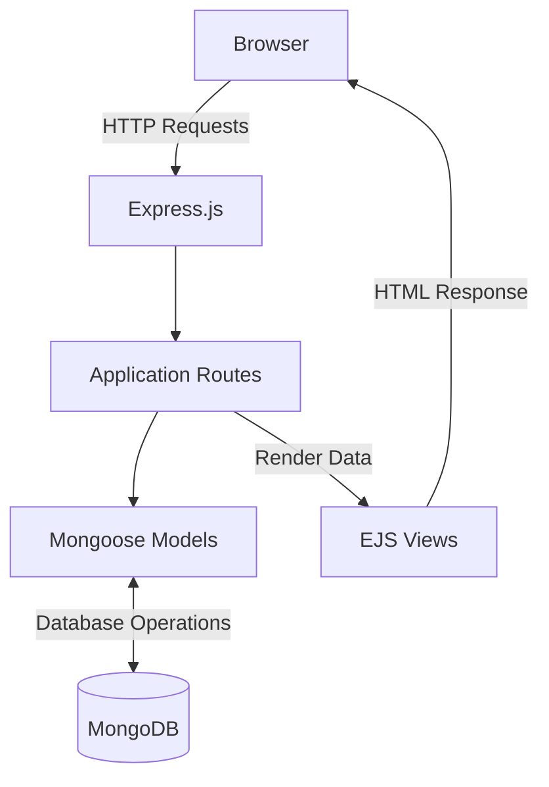

# UniSpace

### One space for what you think, plan, create, and want to find again.

UniSpace addresses the everyday friction of managing information across multiple tools. Tasks get lost among notes, useful resources become buried in browser bookmarks and ideas end up scattered across different places. UniSpace brings these disconnected pieces together in one personal workspace, making it easier to organize what matters, keep track of ongoing work and find important information whenever you need it.

**Node.js 22 · Express · EJS · Mongoose · MongoDB 6 · Docker Compose**

---

## Getting Started

### Prerequisites

- Git
- Docker Desktop or Docker Engine with Docker Compose

### Run locally

Clone the repository and navigate to its root directory:

```bash
git clone <REPOSITORY_URL>
cd <REPOSITORY_NAME>
```

Start the application:

```bash
docker compose up --build -d
```

Open **http://localhost:3000**.

On the first run, Docker builds the application image and downloads MongoDB. Compose waits for the database health check before starting the application.

### Useful commands

```bash
# Check running services
docker compose ps

# Follow application logs
docker compose logs -f todo-app

# View database logs
docker compose logs -f todo-database

# Stop containers while preserving database data
docker compose down
```

### Data persistence

MongoDB stores application data in the named `database` Docker volume. Normal container stops and rebuilds preserve persisted records.

Avoid `docker compose down -v` unless you intentionally want to delete the database volume.

---

## The Workspace

UniSpace brings five connected areas into one workspace.

| Workspace | Purpose |
|---|---|
| **Dashboard** | Overview of workspace activity, live statistics, recent items and quick actions. |
| **My Tasks** | Manage tasks with descriptions, due dates, priority levels, completion status and bookmarks. |
| **My Pages** | Create and maintain personal notes with editable titles and content. |
| **Knowledge Library** | Save useful URLs with titles, descriptions and categories. |
| **Bookmarks** | Access bookmarked tasks, pages and resources from one place, with links to their original records. |

### A connected workspace

Create a task when something needs to get done. Save an idea as a page. Keep useful websites in the Knowledge Library. Bookmark anything worth revisiting.

The dashboard reflects actual workspace activity, while Bookmarks provides a shared retrieval point across all three content types.

---

## Architecture

UniSpace follows a server-rendered architecture built with Node.js, Express, EJS, Mongoose, and MongoDB.



Docker Compose orchestrates the application and database services.

---

## Technology

**Backend:** Node.js, Express.js

**Database:** MongoDB, Mongoose

**Frontend:** EJS, HTML, CSS, JavaScript

**Containerization:** Docker, Docker Compose

The interface uses a custom responsive design with lavender accents, neutral surfaces, and layouts adapted for smaller screens.

---

## Project Structure

```text
multi-container-app/
│
├── app/
│   ├── server.js
│   ├── routes/
│   │   └── front.js
│   ├── models/
│   │   ├── Todo.js
│   │   ├── Page.js
│   │   └── Resource.js
│   ├── views/
│   │   ├── partials/
│   │   └── ...
│   └── public/
│       └── css/
│           └── styles.css
│
└── compose.yaml
```

---

## Scope

UniSpace is currently designed as a **single-user local workspace**.

It does not currently include user authentication, account management, or multi-user collaboration.

The Docker Compose configuration publishes the application on port `3000` and MongoDB on port `27017`. MongoDB authentication is not configured in this local development setup.

Do not expose this configuration directly to the public internet without implementing appropriate authentication, access controls and database security.
